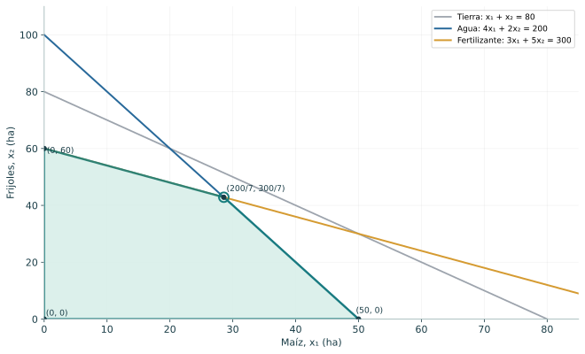
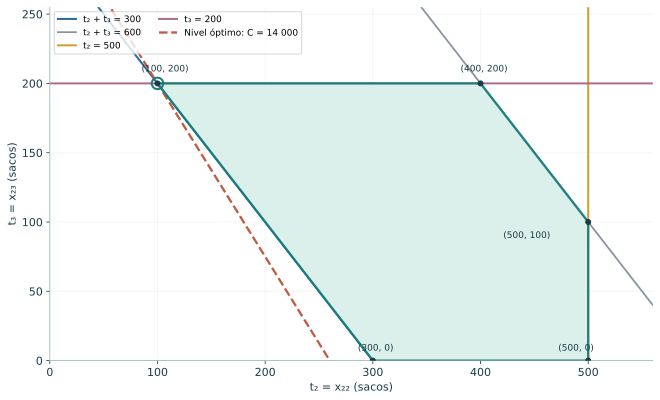

## De una situación real a un modelo matemático

En los apartados anteriores estudiamos las regiones factibles, los vértices y los resultados de optimalidad. Ahora invertiremos la perspectiva: **partiremos de una situación concreta y construiremos el programa lineal que la representa**.

Modelar no es solamente asignar letras a cantidades. Es decidir qué puede elegirse, qué se pretende optimizar y cuáles son las condiciones que toda decisión aceptable debe satisfacer.

::: {.callout-tip title="Una pregunta antes de escribir ecuaciones"}
¿Cuáles cantidades puede decidir la persona responsable del problema y cuáles son datos que ya vienen fijados por el contexto?
:::

En un modelo de programación lineal distinguimos las **variables de decisión**, la **función objetivo**, las **restricciones** y el **dominio de las variables**. También debemos comprobar que las unidades físicas sean consistentes y que las soluciones del modelo tengan significado en la situación original.

## Producción agrícola: distribuir recursos limitados

### El problema

Un agricultor dispone de **80 hectáreas**, **200 unidades de agua de riego** y **300 kg de fertilizante**. Puede sembrar maíz y frijoles. Los consumos por hectárea y las ganancias son los siguientes:

| Concepto (por hectárea) | Maíz | Frijoles |
|:--|--:|--:|
| Agua de riego (unidades) | 4 | 2 |
| Fertilizante (kg) | 3 | 5 |
| Ganancia (unidades monetarias) | 500 | 400 |

**Pregunta:** ¿cuántas hectáreas debe dedicar a cada cultivo para maximizar la ganancia total sin superar sus disponibilidades?

::: {.callout-note title="Antes de continuar"}
¿Es correcto escribir $x_1+x_2=80$? No necesariamente: disponer de 80 hectáreas no significa estar obligado a cultivar toda la tierra.
:::

### Variables de decisión y función objetivo

Definimos $x_1$ como la cantidad de hectáreas destinadas al maíz y $x_2$ como la cantidad de hectáreas destinadas a los frijoles. Como las ganancias por hectárea son 500 y 400 unidades monetarias, respectivamente, la ganancia total es

$$z=500x_1+400x_2.$$

Por tanto, se busca **maximizar** $z$.

### Restricciones y sus unidades

- **Tierra:** cada hectárea sembrada utiliza una hectárea del terreno disponible, por lo que $x_1+x_2\leq80$.
- **Agua:** sembrar $x_1$ hectáreas de maíz requiere $4x_1$ unidades de agua y sembrar $x_2$ hectáreas de frijoles requiere $2x_2$, de modo que $4x_1+2x_2\leq200$.
- **Fertilizante:** el consumo total es $3x_1+5x_2$ kg; por consiguiente, $3x_1+5x_2\leq300$.
- **No negatividad:** $x_1,x_2\geq0$.

Reunimos las condiciones en el programa lineal

$$
\begin{aligned}
\text{Maximizar}\quad &z=500x_1+400x_2\\
\text{sujeto a}\quad &x_1+x_2\leq80,\\
&4x_1+2x_2\leq200,\\
&3x_1+5x_2\leq300,\\
&x_1,x_2\geq0.
\end{aligned}
$$

### Interpretación geométrica y solución

La región factible es la intersección de los semiplanos definidos por las tres disponibilidades y el primer cuadrante. Las restricciones de agua y fertilizante se intersectan en

$$
\begin{cases}
4x_1+2x_2=200,\\
3x_1+5x_2=300,
\end{cases}
\qquad\Longrightarrow\qquad
(x_1,x_2)=\left(\frac{200}{7},\frac{300}{7}\right).
$$

En este punto se utilizan $\frac{500}{7}<80$ hectáreas, es decir, la restricción de tierra no es activa. La ganancia correspondiente es

$$z^*=500\left(\frac{200}{7}\right)+400\left(\frac{300}{7}\right)
=\frac{220000}{7}\approx31428{,}57.$$

La figura representa las tres rectas frontera y el polígono factible sombreado. Cada vértice resulta de la intersección de dos fronteras activas (incluidos los ejes).

{#fig-region-agricola width="94%" fig-align="center"}

Para justificar que es el máximo, podemos comparar el valor de la función objetivo en los vértices de la región factible: $(0,0)$, $(50,0)$, $\left(\frac{200}{7},\frac{300}{7}\right)$ y $(0,60)$. Los valores respectivos son $0$, $25000$, $\frac{220000}{7}$ y $24000$.

::: {.callout-important title="Interpretación, no solo resultado"}
El modelo recomienda sembrar aproximadamente **28,57 hectáreas de maíz** y **42,86 hectáreas de frijoles**. Se agotan el agua y el fertilizante, pero queda terreno sin cultivar. Esto no es una contradicción: **el recurso limitante no tiene por qué ser la tierra**.
:::

Si se exigieran hectáreas enteras, ya no estaríamos ante este mismo programa lineal continuo: habría que incorporar restricciones de integridad, que estudiaremos posteriormente.

## Transporte de arroz: un modelo de distribución

### El problema

Una empresa arrocera tiene dos plantas, $P_1$ y $P_2$, que deben enviar **toda su producción semanal** a tres supermercados, $S_1$, $S_2$ y $S_3$. Cada supermercado debe recibir **exactamente** su demanda.

Los costos de transporte se indican en **miles de colones por saco**:

| Origen | $S_1$ | $S_2$ | $S_3$ | Producción (sacos) |
|:--|--:|--:|--:|--:|
| $P_1$ | 12 | 15 | 14 | 400 |
| $P_2$ | 10 | 18 | 16 | 600 |
| **Demanda (sacos)** | **300** | **500** | **200** | **1000** |

Observá que la oferta total es $400+600=1000$ sacos y la demanda total es $300+500+200=1000$ sacos. El problema está **balanceado**.

### Variables de decisión

Para $i\in\{1,2\}$ y $j\in\{1,2,3\}$, definimos $x_{ij}$ como la cantidad de sacos enviados desde la planta $P_i$ hasta el supermercado $S_j$.

En particular, tenemos **seis variables**, una por cada ruta de transporte. Por ejemplo, $x_{12}$ representa los sacos enviados de $P_1$ a $S_2$.

### Objetivo y restricciones

El costo total, expresado en miles de colones, es

$$C=12x_{11}+15x_{12}+14x_{13}+10x_{21}+18x_{22}+16x_{23}.$$

La producción de cada planta debe enviarse completamente:

$$x_{11}+x_{12}+x_{13}=400,\qquad x_{21}+x_{22}+x_{23}=600.$$

Cada supermercado debe recibir exactamente lo requerido:

$$
\begin{aligned}
x_{11}+x_{21}&=300,\\
x_{12}+x_{22}&=500,\\
x_{13}+x_{23}&=200.
\end{aligned}
$$

Además, $x_{ij}\geq0$ para todas las rutas. Así, el objetivo consiste en **minimizar $C$** sujeto a estas cinco igualdades y a la no negatividad.

::: {.callout-note title="¿Por qué igualdades y no desigualdades?"}
En este contexto no se permite almacenar sacos en las plantas ni entregar más o menos de lo solicitado. Esa interpretación determina el signo $=$ de las restricciones.
:::

### Reducción por eliminación de Gauss–Jordan

El modelo tiene seis variables y cinco igualdades. Como la oferta total coincide con la demanda total, **una de las ecuaciones es combinación de las otras cuatro**; por ello quedan dos grados de libertad. Para ver esa relación explícitamente, escribimos el sistema en el orden

$$
(x_{11},x_{12},x_{13},x_{21},x_{22},x_{23}).
$$

La matriz aumentada inicial es

$$
\left(\begin{array}{rrrrrr|r}
1&1&1&0&0&0&400\\
0&0&0&1&1&1&600\\
1&0&0&1&0&0&300\\
0&1&0&0&1&0&500\\
0&0&1&0&0&1&200
\end{array}\right).
$$

**Primeros pivoteos.** Aplicamos las operaciones elementales $F_3\leftarrow F_3-F_1$, $F_2\leftrightarrow F_3$ y $F_2\leftarrow -F_2$. La matriz queda

$$
\left(\begin{array}{rrrrrr|r}
1&1&1&0&0&0&400\\
0&1&1&-1&0&0&100\\
0&0&0&1&1&1&600\\
0&1&0&0&1&0&500\\
0&0&1&0&0&1&200
\end{array}\right).
$$

**Eliminación en la segunda columna.** Realizamos $F_1\leftarrow F_1-F_2$, $F_4\leftarrow F_4-F_2$, $F_3\leftrightarrow F_4$ y $F_3\leftarrow-F_3$, obteniendo

$$
\left(\begin{array}{rrrrrr|r}
1&0&0&1&0&0&300\\
0&1&1&-1&0&0&100\\
0&0&1&-1&-1&0&-400\\
0&0&0&1&1&1&600\\
0&0&1&0&0&1&200
\end{array}\right).
$$

Finalmente, mediante

$$
\begin{aligned}
F_2&\leftarrow F_2-F_3, & F_5&\leftarrow F_5-F_3,\\
F_1&\leftarrow F_1-F_4, & F_3&\leftarrow F_3+F_4,\\
F_5&\leftarrow F_5-F_4,
\end{aligned}
$$

se obtiene **la matriz reducida**:

$$
\boxed{\left(\begin{array}{rrrrrr|r}
1&0&0&0&-1&-1&-300\\
0&1&0&0&1&0&500\\
0&0&1&0&0&1&200\\
0&0&0&1&1&1&600\\
0&0&0&0&0&0&0
\end{array}\right)}.
$$

::: {.callout-tip title="¿Qué representa la fila nula?"}
La última fila es $0=0$. Expresa la dependencia entre oferta y demanda; **no significa que el modelo carezca de restricciones**. Como hay cuatro pivotes en seis columnas, podemos tomar dos variables libres.
:::

### Variables libres y expresiones de las variables originales

Elegimos $t_2=x_{22}$ y $t_3=x_{23}$. De la matriz reducida obtenemos

$$
\begin{aligned}
x_{11}&=-300+t_2+t_3, & x_{12}&=500-t_2,\\
x_{13}&=200-t_3, & x_{21}&=600-t_2-t_3,\\
x_{22}&=t_2, & x_{23}&=t_3.
\end{aligned}
$$

Estas expresiones permiten recuperar **las seis rutas de transporte** una vez que conozcamos los valores óptimos de $t_2$ y $t_3$.

### Restricciones de no negatividad y modelo reducido

No basta con satisfacer las igualdades: todos los envíos deben ser no negativos. Sustituyendo cada expresión anterior,

$$
\begin{aligned}
-300+t_2+t_3&\geq0, & 500-t_2&\geq0,\\
200-t_3&\geq0, & 600-t_2-t_3&\geq0,\\
t_2&\geq0, & t_3&\geq0.
\end{aligned}
$$

Por tanto, la región factible reducida queda dada por

$$
\mathcal R=\left\{(t_2,t_3)\in\mathbb R^2:
\begin{array}{l}
t_2+t_3\geq300,\\
t_2+t_3\leq600,\\
t_2\leq500,\quad t_3\leq200,\\
t_2,t_3\geq0
\end{array}\right\}.
$$

### Región factible reducida y vértices

En la @fig-region-transporte aparecen las rectas frontera, el polígono factible sombreado, los vértices y la recta de nivel correspondiente al costo mínimo. El problema de seis variables puede ahora **analizarse geométricamente en dos variables**.

{#fig-region-transporte width="94%" fig-align="center"}

Los vértices de $\mathcal R$ son

$$
(100,200),\quad (400,200),\quad(500,100),\quad(500,0),\quad(300,0).
$$

### Sustitución y función objetivo reducida

Al sustituir las seis expresiones en el costo total, obtenemos

$$
\begin{aligned}
C={}&12(-300+t_2+t_3)+15(500-t_2)+14(200-t_3)\\
&+10(600-t_2-t_3)+18t_2+16t_3\\
={}&12700+5t_2+4t_3.
\end{aligned}
$$

La nueva formulación, equivalente a la original, es

$$
\boxed{\begin{aligned}
\text{Minimizar}\quad &C=12700+5t_2+4t_3\\
\text{sujeto a}\quad & (t_2,t_3)\in\mathcal R.
\end{aligned}}
$$

Para decidir cuál vértice proporciona el costo mínimo evaluamos la función objetivo:

| Vértice $(t_2,t_3)$ | $C=12700+5t_2+4t_3$ (miles de colones) |
|:--:|--:|
| $(100,200)$ | **14000** |
| $(400,200)$ | 15500 |
| $(500,100)$ | 15600 |
| $(500,0)$ | 15200 |
| $(300,0)$ | 14200 |

El mínimo se alcanza en $(t_2^*,t_3^*)=(100,200)$, marcado en la figura. **No se ha utilizado el método Simplex.**

### Recuperación de la solución original

Sustituimos $t_2=100$ y $t_3=200$ en las expresiones obtenidas por Gauss–Jordan:

$$
\begin{aligned}
x_{11}^*&=-300+100+200=0, &x_{12}^*&=500-100=400,\\
x_{13}^*&=200-200=0, &x_{21}^*&=600-100-200=300,\\
x_{22}^*&=100, &x_{23}^*&=200.
\end{aligned}
$$

La distribución óptima es

| Ruta | Sacos enviados |
|:--|--:|
| $P_1\to S_1$ | 0 |
| $P_1\to S_2$ | 400 |
| $P_1\to S_3$ | 0 |
| $P_2\to S_1$ | 300 |
| $P_2\to S_2$ | 100 |
| $P_2\to S_3$ | 200 |

El costo mínimo es $C^*=14000$ **miles de colones**, es decir, **14 millones de colones**. Podemos comprobar directamente que todas las ofertas y demandas se satisfacen.

::: {.callout-important title="La idea matemática"}
La reducción por Gauss–Jordan conserva el sistema de igualdades; las restricciones de no negatividad se trasladan a las variables libres. Solo después de obtener **toda la región factible reducida** es válido resolver el problema gráficamente y reconstruir las decisiones originales.
:::

## Comparación de los dos modelos

| Característica | Producción agrícola | Transporte de arroz |
|:--|:--|:--|
| Decisiones | Hectáreas por cultivo | Sacos por ruta |
| Objetivo | Maximizar ganancias | Minimizar costos |
| Restricciones principales | Disponibilidades máximas | Ofertas y demandas exactas |
| Variables | 2 | 6 |
| Geometría | Representación directa en el plano | Reducción a dos variables |

La estructura matemática depende del significado de los datos. No existe una regla que obligue a que todas las restricciones sean del mismo tipo.

## Actividades de comprensión

### Actividad: validar un modelo

En el problema agrícola, una persona propone reemplazar $x_1+x_2\leq80$ por $x_1+x_2=80$.

1. Explicá qué supuesto adicional estaría incorporando.
2. Determiná si el plan óptimo encontrado seguiría siendo factible.
3. Describí una situación real en la que sí sería apropiada la igualdad.

### Actividad: interpretar una ruta

En el problema de transporte, suponé que el costo de la ruta $P_1\to S_2$ aumenta de 15 a 20 miles de colones por saco.

1. Escribí la nueva función objetivo; no modifiqués las restricciones.
2. Evaluá el costo de la distribución óptima anterior con el nuevo precio.
3. Explicá por qué ese cálculo **no basta** para afirmar que la distribución anterior sigue siendo óptima.

### Actividad: formular sin resolver

Una cooperativa fabrica dos productos, $A$ y $B$. Cada unidad de $A$ requiere 2 horas de máquina y 3 kg de materia prima; cada unidad de $B$ requiere 4 horas y 1 kg. Se dispone de 40 horas de máquina y 36 kg de materia prima. La ganancia por unidad es de 70 y 50 unidades monetarias, respectivamente.

Definí las variables y formulá el programa lineal que maximiza la ganancia. Indicá el significado de cada restricción y sus unidades. **No utilicés el método Simplex.**

## Ideas para recordar

- Una variable de decisión representa una cantidad que puede elegirse y debe tener unidades claras.
- Una restricción expresa una condición del contexto; su sentido ($\leq$, $\geq$ o $=$) debe justificarse.
- Las restricciones no negativas también forman parte del modelo.
- La solución matemática debe interpretarse y verificarse en el problema original.
- Modelos con muchas variables pueden admitir reducciones, pero no toda reducción conserva una interpretación sencilla.

::: {.callout-tip title="Conexión con el resto del libro"}
En el método gráfico aprovechamos la estructura geométrica de problemas de dos variables. Más adelante, el método Simplex permitirá resolver modelos con muchas variables sin depender de su representación gráfica.
:::
